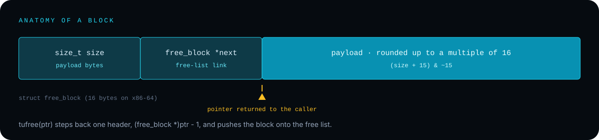

<p align="center">
  
</p>

<p align="center">
  <b><code>malloc</code>, <code>calloc</code>, <code>realloc</code> and <code>free</code>, written from scratch in C on top of <code>sbrk()</code>.</b><br/>
  <sub>Project 2 for CYB-3053 Operating Systems Concepts at The University of Tulsa</sub>
</p>

---

## What this is

`tumalloc` is a small user-space heap allocator. It asks the kernel for memory by moving the program break with
`sbrk()`, carves that memory into blocks, and tracks free blocks in a singly linked **free list**. The extra-credit
part swaps first-fit for **next-fit**, which resumes each search where the previous one left off.

The course provided the project skeleton (CMake setup, `alloc.h` and a linked-list test driver in `main.c`). The allocator
in `src/alloc.c` is my implementation.

## The API

| Function | Behaviour in this implementation |
|---|---|
| `void *tumalloc(size_t size)` | Rounds `size` up to a multiple of 16, then walks the free list from the next-fit pointer. It splits a block that is too big. If nothing fits, it grows the heap with `sbrk()` |
| `void *tucalloc(size_t num, size_t size)` | Checks `num * size` for overflow and returns `NULL` if it would wrap, then calls `tumalloc` and zero-fills with `memset` |
| `void *turealloc(void *ptr, size_t new_size)` | `NULL` behaves like `tumalloc`. If the block is already big enough, it returns `ptr` unchanged. Otherwise it allocates, copies with `memcpy`, and frees the old block |
| `void tufree(void *ptr)` | Steps back one header and pushes the block onto the head of the free list. `NULL` is a no-op |

## Inside a block

<p align="center">
  
</p>

```c
typedef struct free_block {
    size_t size;               // payload bytes
    struct free_block *next;   // next block in the free list
} free_block;
```

Supporting pieces in `alloc.c`:

- **`split()`** shrinks an oversized block to the requested size and writes a new header for the remainder.
- **`find_prev()` / `find_next()`** find the free blocks that are physically adjacent to a given block.
- **`coalesce()`** merges a block with free neighbours that touch it in memory. It runs when `do_alloc()` adds fresh `sbrk` memory to the list.

## Build and run

The project targets Linux, WSL or another POSIX environment (`sbrk` and `unistd.h`), with GCC and CMake 3.20+.

```bash
./build.sh                       # mkdir build && cmake -DCMAKE_BUILD_TYPE=Release .. && make
./build/cyb3053_project2         # runs the linked-list test driver in src/main.c
```

The driver builds and walks a linked list, then exercises `tucalloc` and `turealloc` on arrays, printing values as it
goes. The allocator also prints debug lines (`Allocating N bytes`, `allocated memory: 0x…`, `freed memory: 0x…`), so
you can watch the next-fit pointer and the free list at work.

> These instructions come from the repo's `build.sh` and `CMakeLists.txt`. They were not re-run as part of the README
> update, because there was no POSIX toolchain on the machine used for it.

## Notes and known limitations

This is a learning allocator, and it's honest about its edges:

- `tufree()` doesn't coalesce on free. Adjacent freed blocks stay separate until a later `do_alloc()` coalesce.
- When `tumalloc()` splits a block, the remainder's header is written but not linked back into the free list, so that space isn't reused.
- `header.magic` is declared in `alloc.h` but not used for validation, so double frees and stray pointers aren't detected.
- The allocator isn't thread-safe and prints debug output on every call.

These would be natural next steps: relink split remainders, coalesce in `tufree`, and check a magic number on free.

## Repository layout

```text
src/alloc.h        block structs and the public API
src/alloc.c        the allocator (split, coalesce, next-fit, sbrk)
src/main.c         linked-list test driver (course-provided)
CMakeLists.txt     build definition
build.sh           convenience build script
```

<details>
<summary><b>Original assignment notes (from the course template)</b></summary>

Use the same environment you used for Project 1 (WSL, a Linux VM, Cygwin, other). Windows is not supported.

To compile: at the top-level directory (where you should see `CMakeLists.txt`, `build.sh` and `src/`), run `./build.sh`.
A new directory called `build` is created. Run the program by going into that directory and running `./cyb3053_project2`.

Requirements: a compiler (gcc) and CMake (on WSL: `sudo apt install cmake`).

</details>
